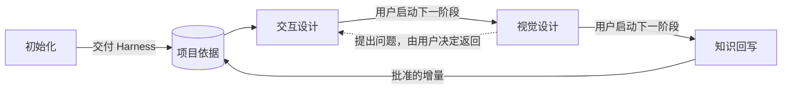

# Design Harness


以项目 Figma 为知识和交接载体的 Codex 设计插件。初始化、交互设计、视觉设计、知识回写各有独立入口，由用户决定何时启动、继续或返回。

## 四个阶段

| 入口 | 输入 | 本阶段交付与停止点 |
| --- | --- | --- |
| `$design-harness-init` | Figma 项目与代码仓库 | 逐模块确认存量知识与 Library 来源，补齐代码已有而设计缺失的资产；交付 Harness 与初始化记录后停止 |
| `$design-harness-interaction` | 新需求、项目依据或交互交接 | 逐题访谈，先确认流程骨架和主流程可点击低保真原型，再逐条完成分支；交付交互基线后停止 |
| `$design-harness-visual` | 已确认的交互或行为明确的现有界面 | 先访谈目标并比较 2–3 套代表方案，选主方向及整合确认后完整展开；交付确认稿与候选知识增量后停止 |
| `$design-harness-writeback` | 已确认设计与候选知识增量 | 展示具体增量，按批准范围更新 Harness 资源、状态与索引；核验实际结果后停止 |



每个入口配置 `allow_implicit_invocation: false`，不自动串联阶段、不自动创建任务。建议每个阶段新开任务，只带交付物和确认结论；同一任务切换 Skill 不会清空此前上下文。已有项目可从适用阶段开始，不强制空跑前置阶段。

示例：

> 用 $design-harness-interaction 读取这个项目的 Harness，先梳理流程。主流程原型确认后再逐条做分支，完成后给我交接链接。

> 用 $design-harness-visual 承接这份交互交接，先访谈视觉目标，再给我 2–3 套代表方案。选主方向并整合确认后再完整展开；交互问题由我决定是否返回。

> 用 $design-harness-writeback 读取这份确认稿，列出具体知识增量，按已批准范围更新 Harness。

会话已有范围与明确确认时直接沿用。可查询事实先自行核实，访谈每次一个问题并给推荐理由。设计确认、验证结果与回写授权分别保留；下游不能以优化为由改写上游已确认的行为。

## 视觉探索与选择

视觉阶段采用“目标访谈 → 2–3 套代表方案 → 对比访谈 → 选主方向并按需融合 → 整合稿确认 → 完整展开”。每项新的视觉需求默认执行，小修改也展示备选并确认；已有风格用于约束探索范围。大需求选择关键页面，小修改聚焦受影响区域，在相同内容、状态、尺寸和交互约束下比较实际画面。

每套方案说明目标、差异、收益与代价，Agent 给出推荐及理由，再逐题讨论具体取舍。用户可以选一个主方向并吸收其他方案的局部优点；整合后检查一致性，确认该代表版本，再展开全部页面。交接保留当前步骤、方案链接、选择理由、融合范围和未决项；同一项需求跨任务或中断恢复时继续已有进度，不重做已完成的探索。详细规则见 [视觉工作流](skills/design-harness-visual/references/workflow.md) 和 [访谈机制](skills/design-harness-visual/references/interview.md)。

## 交接与恢复

每个阶段在已授权 Figma 区域维护可见原生 TEXT `DH / Handoff`：Init 位于 Harness Page，其余位于同一需求 Page 的各自区域。记录目标与范围、采用的上游版本、当前步骤、真实产物链接、实际确认、未决/暂缓/待验证项和下一步；不保存整段对话、第三方手册或工具日志。

新任务或上下文压缩后，先读当前阶段的 [交接约定](skills/design-harness-interaction/references/handoff.md) 和指定交接节点，再核对真实产物，按当前问题补读项目资源。记录过期或冲突时只核实影响当前决定的缺口，不能凭“已完成”文字推定资产或批准存在。Figma 暂不可写时报告尚未持久化的限制。

[交接蓝图](skills/design-harness-interaction/assets/stage-handoff.txt) 是表达结构，不是自动状态机。用户控制跨阶段启动与返回；部分交付不会自动推动后续工作，也不要求创建本地 brief、run.json 或其他流程档案。

## 项目知识与渐进读取

- **Harness Page**：项目上下文、设计风格、Tokens/变量、布局、组件、模板、场景及需求索引。变量和样式本身是文件级资产，组件必须是原生资产。
- **独立需求 Page**：交互产物、视觉产物和各阶段交接，已确认版本与候选修改保持可区分。
- **代码仓库**：核查当前实现的依据；入口只留一条经 remote 核实的仓库链接。源码路径、符号、commit 和核查日志由 Agent 按需查询，不进入 Figma 正文或隐藏附录。
- **本插件**：通用方法、读取助手、内容蓝图和维护工具，不包含具体业务项目记录。

读取遵循入口 → 相关模块 → 必要资源 → 实际资产与依赖。具体页面行为归布局、组件或场景，项目上下文保留产品定位、用户任务、使用环境、渠道差异和业务边界。当前实现、已确认待实现设计与验证限制分开保留，旧代码不推翻已确认的未来设计。

[上下文契约](skills/design-harness-init/references/context-contract.md) 用于建立知识，[读取约定](skills/design-harness-interaction/references/context-loading.md) 用于按需使用。旧 Contract 1 保持可读，不因新增交接结构或资源名称要求重建整个项目。

## 视觉资产与外部方法

先查项目认可来源、已启用团队 Library 和本次相关的可访问库，再按适用性复用。检索受限、没有匹配资产和确实不存在分别表达；查库不自动授权启用、发布或改源库。

Init 登记既有规则；视觉阶段按需使用 [资产选择](skills/design-harness-visual/references/visual-assets.md)、[图标方法](skills/design-harness-visual/references/iconography.md) 或 [插画方法](skills/design-harness-visual/references/illustration.md)。通用图标优先一致的矢量，功能关系用可编辑示意图，情境插画按上下文生成并检查实际导入、透明背景、裁切和渲染。颜色沿用项目语义变量。图标和插画仍是内部能力，不另增公开入口。

产品界面与评审说明以图形配必要短文降低理解成本。保留有歧义图标的短标签、操作后果、必要规则和真实定位，不用删字指标替代清晰度。

交互、视觉各自按问题取用 Impeccable 和 UI/UX Pro Max；先定位相关章节，再读取必要段落，不先加载完整 Skill 或审计流程。Init 与视觉维护的设计语言描述参考 [Google DESIGN.md](https://github.com/google-labs-code/design.md)，关联视觉意图、用途、边界和真实 token，项目内容留在 Figma 的 `style/design-description`，不强制本地 DESIGN.md。知识回写只转写已确认描述。

外部内容读取官方现行页面或默认分支最新部分，不固定版本或分发手册快照；项目规范优先。访问失败时说明限制。Lucide、NN/g、IBM 与 Atlassian 的方法及许可边界见 [视觉指导声明](skills/design-harness-visual/third-party/visual-assets/NOTICE.md)，方法参考与素材授权分别判断。

## 文档与原生资产

[工作模板约定](skills/design-harness-init/references/work-templates.md) 与 [蓝图](skills/design-harness-init/assets/figma-work-templates.json) 提供场景流程、代表方案对比、规范资源三种结构。按当前操作读取所需部分，优先使用项目兼容的原生模板。蓝图 1.5.0 支持选择理由、融合范围与整合代表稿的呈现，是构建依据，不是已安装的组件库。

项目文档的字体、配色、参与端名称、画面比例和原生模板引用登记在设计风格模块 `documentation/work-templates`，产品 UI 模板独立维护。文档用可见原生富文本和 Auto Layout 表达层级，保留语义 TEXT 的完整定位，回读和实际截图分别检查；不能整篇同字号平铺或用位图替代规则。旧内容迁移只在明确批准的范围进行。

## Skill 组织与连接器

每个 Skill 自包含 `SKILL.md`、`agents/`、`references/`、`assets/`、`scripts/` 和适用许可证。入口只路由当前阶段；共享内容按使用方复制并做一致性校验，不引用插件根目录或兄弟 Skill。交互不携带插画生成与回写指引，知识回写不携带设计访谈或第三方设计指南。

```text
skills/
  design-harness-init/
  design-harness-interaction/
  design-harness-visual/
  design-harness-writeback/
```

先发现工具和实际参数，再探测连接并核对文件/Page，按本次操作选择专用工具或脚本。支持 figma-console-mcp 与 `use_figma`，不把任一连接器设为硬依赖。工具已注册不等于已连接；某工具的 fileKey 不代表切换了其他工具的活动文件。超时先查实际结果，只补缺项，不换连接器重放整次写入。

插件不自带 Figma 账号权限或图像生成服务。能力不足时继续有依据的调查和可审阅工作，明确尚未生成的资产与验证限制。

图标品牌资源由根目录管理，四个色块与透明 H 留白共用浅深图形；见 [品牌说明](assets/README.md)。它们不属于 Skill 的运行依赖。

## 安装与团队分发

源码修改不会自动更新已安装插件；新入口需发布或按本地开发流程刷新后生效。当前基础版本为 **0.1.1**。团队成员可直接从 GitHub 安装：

```sh
codex plugin marketplace add MinLeeV5/design-harness --ref main
codex plugin add design-harness@design-harness
```

安装后新建任务，显式调用所需阶段 Skill。更新时执行：

```sh
codex plugin marketplace upgrade design-harness
codex plugin add design-harness@design-harness
```

仓库内的 [marketplace 入口](.agents/plugins/marketplace.json) 指向根目录插件，安装到本地的代码来自所选 Git 引用。Git 来源与更新命令见 [OpenAI 官方说明](https://developers.openai.com/plugins/build/plugins#add-a-marketplace-from-the-cli)。

本机开发调试仍可使用 personal marketplace：通过 plugin-creator 的本地更新流程刷新缓存并重新安装。`+codex.*` 后缀仅用于本地调试，不带入发布版本；发布时同步插件清单、`package.json` 和锁文件的版本。不要手动修改安装缓存或 Codex 的 marketplace 配置。

本地校验、测试和打包统一使用 **Node.js 22+ 与 ESM**。准备 Node.js 与 npm 后，执行：

```sh
npm ci
npm run validate
npm test
npm run package -- --out dist/build
```

仓库的 [.nvmrc](.nvmrc) 默认选择 Node.js 22；使用 nvm 时可先执行 `nvm use`。

`npm run check` 可一次完成校验和全部测试。打包使用 [fflate](https://github.com/101arrowz/fflate) 这一项开发依赖；依赖安装后，校验、测试与打包均可离线运行。直接使用这些 Skill 不需要安装这些开发依赖。

输出 zip 与 SHA-256，重复构建使用新的输出目录，避免覆盖旧包。解压后包含 marketplace 根目录和插件：

```text
design-harness/
  .agents/plugins/marketplace.json
  plugins/design-harness/
```

团队成员解压到固定目录，然后使用本机 Codex CLI：

```sh
codex plugin marketplace add /path/to/design-harness
codex plugin add design-harness@design-harness
```

上述路径是解压后的 marketplace 根目录，需要替换为实际位置；解压后的源目录需保留。此操作注册本地包，不发布到远端市场。安装后新建任务使用所需阶段入口。

## 维护与验证

- [Init](skills/design-harness-init/SKILL.md) · [交互](skills/design-harness-interaction/SKILL.md) · [视觉](skills/design-harness-visual/SKILL.md) · [知识回写](skills/design-harness-writeback/SKILL.md)
- [交接契约](skills/design-harness-interaction/references/handoff.md) · [原型制作](skills/design-harness-interaction/references/prototyping.md) · [知识增量](skills/design-harness-writeback/references/knowledge-update.md)
- [验证范围与试运行情境](docs/validation.md) · [仓库协作规范](AGENTS.md)

自动检查覆盖四个入口的结构、独立复制、共享资源、交接文本的有界读取与打包一致性。它们不能证明真实 Figma 交互、设计质量、用户批准或上下文压缩后的行为；实际项目需要分别核验。

原创部分与 UI/UX Pro Max 适配采用 MIT；Impeccable 与 DESIGN.md 适配采用 Apache-2.0；Lucide 方法适配保留 ISC 许可及上游附带声明。外部页面和素材不属于本插件许可范围，详见 [原创许可证](LICENSE) 及各阶段的来源说明。
