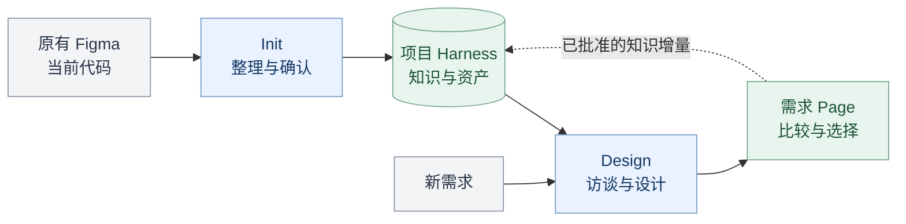
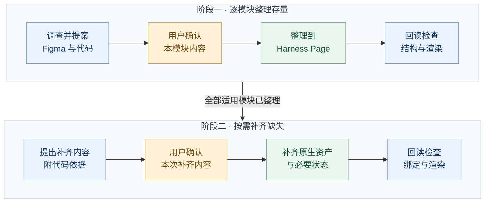
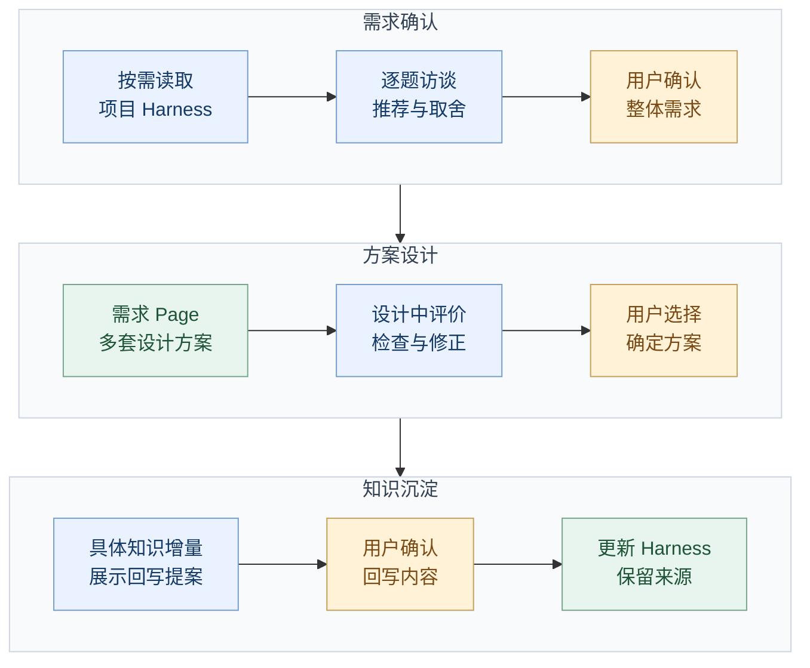
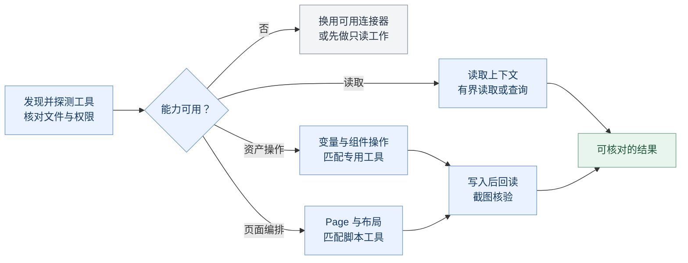

# Design Harness


一个以项目 Figma 为知识载体的 Codex 设计插件。提供两个入口：**Init 建立项目上下文，Design 在项目约束下完成新需求设计**。

图标以四个彩色组件围绕 H 留白组成。浅色与深色使用同一份透明图形，插件主题色为紫色；配色和资源用法见[品牌资源](assets/README.md)。



插件提供通用方法，项目的设计知识与资产沉淀在 Figma；每次需求产生的已确认知识再回到项目 Harness。

## 使用

| 入口 | 给它什么 | 它会做什么 |
| --- | --- | --- |
| `$design-harness-init` | Figma 项目 + 代码仓库 | 先整理现状，逐模块确认，再补齐代码已有而 Figma 缺失的知识与资产 |
| `$design-harness-design` | Figma 项目 + 新需求 | 读取入口并按需加载资源，逐题访谈，确认后生成多个方案，选定后确认知识回写 |

示例：

> 用 $design-harness-init 根据这个 Figma 项目和代码仓库建立 Harness。先整理现状，每个模块先给我看具体提案，确认后再生成。

> 用 $design-harness-design 读取这个 Figma 项目的 Harness，帮我设计新的设备连接流程。先逐题讨论，再生成方案供我选择。

会话已有 Figma、仓库、范围和确认时直接沿用，不重复要求填写。团队使用需要可访问的项目及 Figma 原生读写能力；本插件不自带 Figma 连接器或账号权限。只有读取能力时仍可完成调查和访谈，写入缺口会明确报告。

## 项目知识放在哪里

- **Figma 的 design-harness Page**：AGENTS 式入口、项目上下文、风格约束、token/变量说明与样例、布局、组件库、模板库、场景库、已确认知识和需求索引。
- **每次需求的独立 Page**：确认后的需求摘要、多方案、关键页面、必要状态、交互说明、选择与知识增量记录。
- **代码仓库**：当前实现和来源映射的依据。项目知识链接到具体文件、符号、资源和版本。
- **这个插件仓库**：通用 Skill、工作流、评价标准、Figma 内容蓝图与读取助手。

变量与样式本身是 Figma 文件级资产，Harness Page 统一呈现其语义、索引和用法。组件必须是可复用的原生资产，索引或截图不能代替组件库。

入口只保留少量全局约束和模块目录。Agent 从入口读到相关模块概览，再读取所需资源和依赖；不会默认把整张 Page 或整个文件加载到上下文。Init 的 [上下文契约](skills/design-harness-init/references/context-contract.md) 定义建立方式，Design 的 [读取约定](skills/design-harness-design/references/context-loading.md) 定义按需读取与回写定位。


## Skill 组织

两个 Skill 各自携带本地文档、蓝图、脚本、外部来源入口和许可证，可以单独复制使用。`SKILL.md` 说明入口与读取时机，参考内容按需加载；需要上游指导时在线读取最新内容。

```text
skills/
  design-harness-init/
    SKILL.md
    agents/openai.yaml
    references/   # 整理流程、上下文契约、模块标准、状态与检查
    assets/       # Harness 入口、模块概览、资源说明蓝图
    scripts/      # Figma 读取助手
    third-party/  # Harness 架构参考的许可证
    LICENSE
  design-harness-design/
    SKILL.md
    agents/openai.yaml
    references/   # 读取、访谈、方案流程、评价、回写、Impeccable
    assets/       # 需求 Page、知识增量、资源说明蓝图
    scripts/      # Figma 读取助手
    third-party/  # 本 Skill 使用的 Impeccable 许可证与声明
    LICENSE
```

根目录保留插件配置、品牌资源、开发校验/打包脚本、测试和维护文档。根目录 `assets/` 仅供插件展示使用；两个 Skill 不依赖这些品牌资源或根目录的运行文档，也不互相跨目录读取。随两者携带的读取助手、资源说明蓝图与原创许可证通过一致性校验保持同步。

## 工作方式

图中的黄色节点表示用户确认或选择，蓝色节点表示整理、设计与检查，绿色节点表示 Figma 中的产物。

### Init：先整理现状，再补齐缺失

两个阶段内部都按模块推进。先把全部适用模块的现状整理清楚，再处理代码已经实现、Figma 尚未覆盖的内容。



若无缺失，阶段一核验完成后即可用于后续设计。未确认的内容继续调整提案；已有同一范围的明确批准时直接沿用。变量、组件、模板和场景需要真实可复用资产，不能只用一份索引表示补齐完成。

### Design：从新需求到可选择的方案

先在项目约束下明确需求，再生成正式方案。评价嵌入设计过程；用户选定方案后，另行确认具体知识增量。



每次提问给出推荐与理由，开放问题、真实取舍、情境检验按需要使用。访谈结论承载于对话，确认后在需求 Page 附摘要；没有本地 `brief.md` 或 `run.json` 要求。

项目规范优先，Impeccable 提供通用补充。默认交付关键页面、必要状态和交互说明；可点击原型按比较需要增加。每个方案必须有实质差异，评价直接检查任务、资产和实际渲染。

第三方资料随所属 Skill 管理：Init 保留 Harness 架构来源，Design 保留 Impeccable 来源与适配规则。每次任务首次需要某份外部指导时，读取上游默认分支的最新相关文档，不固定版本或维护版本锁；同一任务可复用已经读过的内容。获取失败时说明缺口，并继续项目依据能够支持的工作。在线阅读上游指导不要求安装其 CLI、hooks 或完整工作流。

“倾向代码”用于还原当前事实；已确认的新设计可先以**已确认设计／待实现**沉淀，后续盘点不能用旧实现覆盖它。用户已经明确批准的相同内容与范围不重复确认。

## 如何选择 Figma 工具

先发现当前工具，探测连接并核对目标文件，再匹配本次需求。figma-console-mcp 与 `use_figma` 都是可选执行方式；用户指定、目标访问能力和具体操作共同决定选择。



发现 Console 后先检查实际连接。变量批量操作、组件实例化和属性修改优先匹配适用的专用工具；Page 编排与局部脚本可使用 `figma_execute` 或 `use_figma`。只加载所选方式的说明，不通过多个连接器重复执行同一次写入。

工具已注册不代表已连接，也不代表拥有写权限。所有写入仍遵循上方工作流中的确认范围；部分操作不可用时，继续完成其他有依据、可执行的工作。

## 安装与团队分发

当前发布版本为 **0.1.1**。团队成员可直接从 GitHub 安装：

```sh
codex plugin marketplace add MinLeeV5/design-harness --ref main
codex plugin add design-harness@design-harness
```

安装后新建任务，使用 `$design-harness-init` 或 `$design-harness-design`。更新时执行：

```sh
codex plugin marketplace upgrade design-harness
codex plugin add design-harness@design-harness
```

仓库内的 [marketplace 入口](.agents/plugins/marketplace.json) 指向根目录插件，安装到本地的代码来自所选 Git 引用。Git 来源与更新命令见 [OpenAI 官方说明](https://developers.openai.com/plugins/build/plugins#add-a-marketplace-from-the-cli)。

本机开发调试仍可使用 personal marketplace：通过 plugin-creator 的本地更新流程刷新缓存并重新安装。`+codex.*` 后缀仅用于本地调试，不带入发布版本；发布时同步插件清单、`package.json` 和锁文件的版本。不要手动修改安装缓存或 Codex 的 marketplace 配置。

本地校验、测试和打包统一使用 **Node.js 22+ 与 ESM**。准备 Node.js 与 npm 后，执行：

```sh
npm ci
npm run validate
npm test
npm run package -- --out dist/build
```

仓库的 [.nvmrc](.nvmrc) 默认选择 Node.js 22；使用 nvm 时可先执行 `nvm use`。

`npm run check` 可一次完成校验和全部测试。打包使用 [fflate](https://github.com/101arrowz/fflate) 这一项开发依赖；依赖安装后，校验、测试与打包均可离线运行。直接使用两个 Skill 不需要安装这些开发依赖。

输出 zip 与 SHA-256，重复构建使用新的输出目录，避免覆盖旧包。解压后包含 marketplace 根目录和插件：

```text
design-harness/
  .agents/plugins/marketplace.json
  plugins/design-harness/
```

团队成员解压到固定目录，然后使用本机 Codex CLI：

```sh
codex plugin marketplace add /path/to/design-harness
codex plugin add design-harness@design-harness
```

上述路径是解压后的 marketplace 根目录，需要替换为实际位置；解压后的源目录需保留。此操作注册本地包，不发布到远端市场。安装后新建任务使用两个入口。

## 维护与阅读

- [Init 入口](skills/design-harness-init/SKILL.md) · [模块产出标准](skills/design-harness-init/references/modules.md) · [Init 检查](skills/design-harness-init/references/evaluation.md)
- [Design 入口](skills/design-harness-design/SKILL.md) · [访谈机制](skills/design-harness-design/references/interview.md) · [Design 检查](skills/design-harness-design/references/evaluation.md)
- [知识更新](skills/design-harness-design/references/knowledge-update.md) · [Impeccable 指导](skills/design-harness-design/references/impeccable.md)
- [Init 工具选择](skills/design-harness-init/references/figma-operations.md) · [Init Console 操作](skills/design-harness-init/references/figma-console.md) · [Design Console 操作](skills/design-harness-design/references/figma-console.md)
- [Init 来源与许可](skills/design-harness-init/references/sources.md) · [Design 来源与许可](skills/design-harness-design/references/sources.md) · [验证范围](docs/validation.md)

辅助脚本测试验证读取范围、截断续读与分发包一致性，不能证明真实项目的设计质量。实际运行 Init/Design 时仍需按工作流完成具体模块的用户确认、原生资产检查和截图核验。

原创部分采用 [MIT](LICENSE)；Impeccable 适配内容遵循 Apache-2.0，并保留上游声明。
