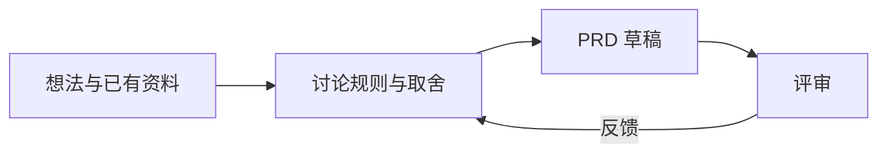
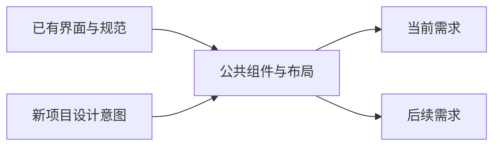
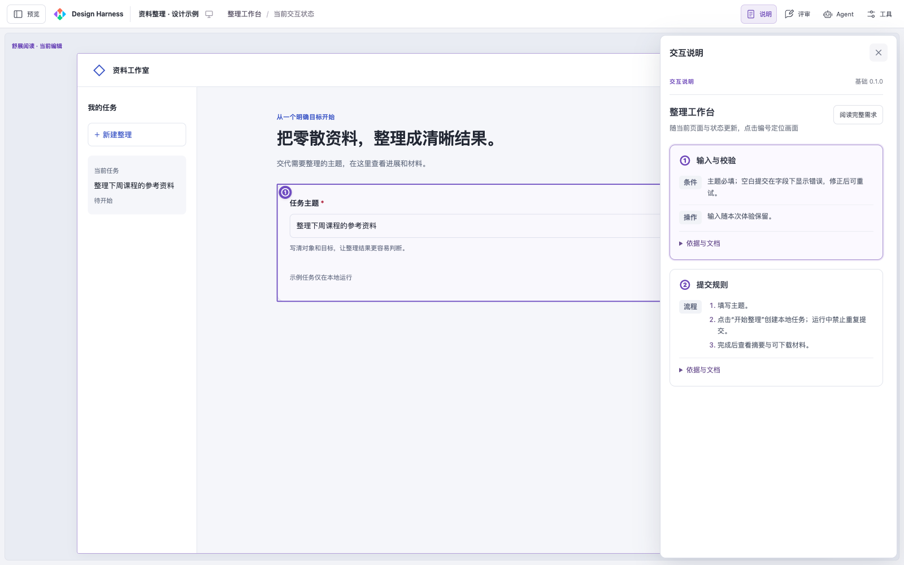
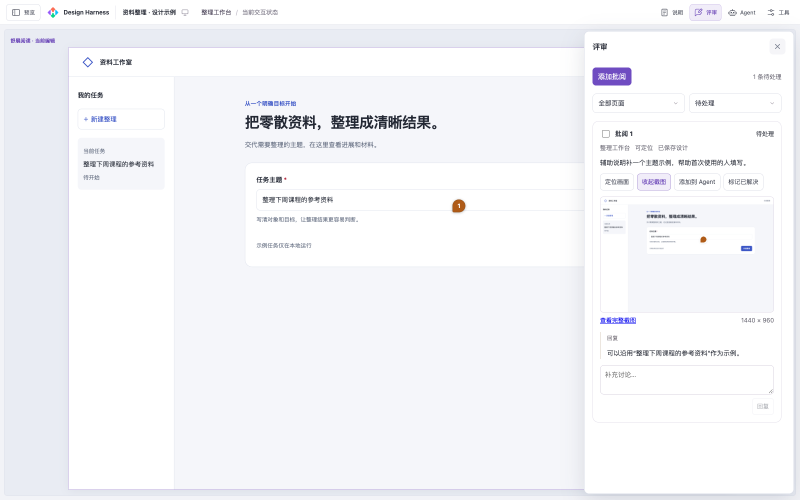
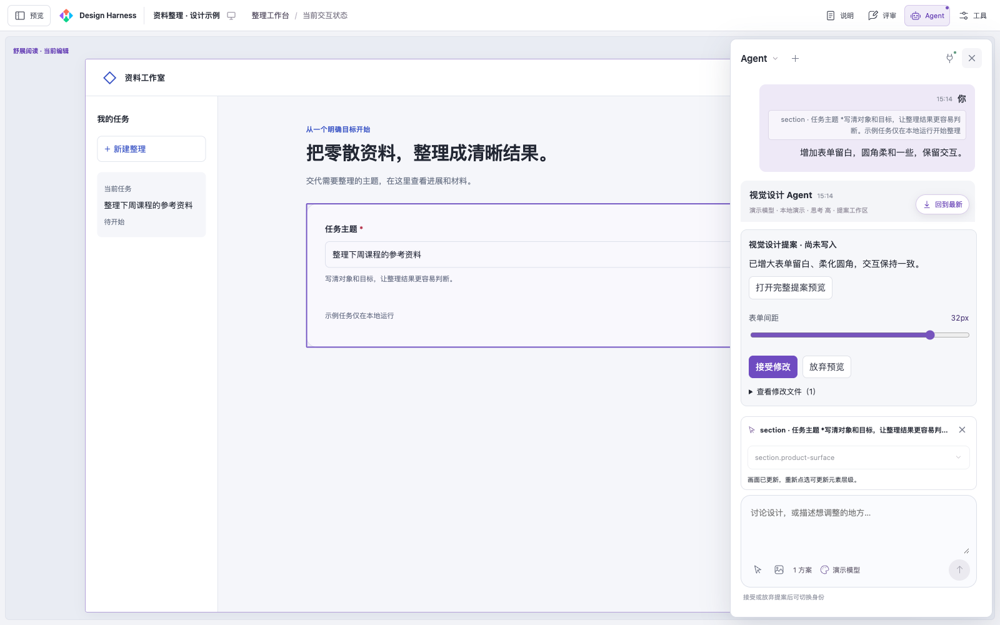
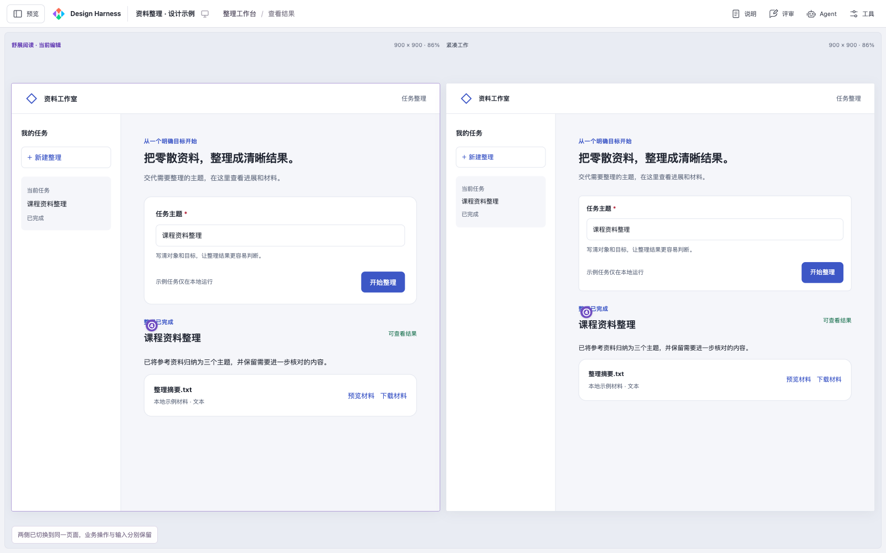
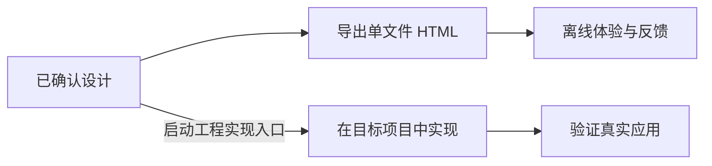

<p align="center">
  
</p>

<h1 align="center">Design Harness</h1>

<p align="center"><strong>先把需求和界面做成可操作的设计，再进入工程实现。</strong></p>

<p align="center">
  <a href="package.json"></a>
  <a href="https://www.npmjs.com/package/@minleev5/design-harness"></a>
  <a href="https://nodejs.org/"></a>
  <a href="LICENSE"></a>
</p>

<p align="center">
  <a href="#快速开始">快速开始</a> ·
  <a href="#五个入口">五个入口</a> ·
  <a href="#重点功能">功能演示</a> ·
  <a href="#适合你吗">优势与取舍</a> ·
  <a href="#进一步阅读">更多文档</a>
</p>

Design Harness 帮你和 Agent 讨论需求、制作交互与视觉方案，在本地工作台体验和修改，再导出 HTML 分享，或交给 Agent 在业务项目中实现。

## 适合你吗

当你还没确定页面怎么组织、流程是否顺畅，或希望先比较几种方案再开发时，可以用它。已有产品可以沿用现有风格，新项目可以从草稿开始。

| 优势 | 需要考虑的成本与限制 |
| --- | --- |
| 开发前就能试用页面、流程和异常状态 | 原型可以模拟数据，真实接口与业务能力仍需在业务项目中实现和验证 |
| 设计资源保存在项目仓库，公共组件可持续复用，用 Git 协作和追踪变化 | 首次需要建立设计基础；公共基础调整后，要检查已有页面 |
| 点选元素提出修改，比较多个可操作方案 | 工作台内的 Agent 依赖本机 Codex；生成质量和最终取舍仍需人工评审 |
| 导出一个 HTML，接收方无需安装工具即可离线体验 | 离线文件不提供 Agent 修改和批阅写入；更新设计后需重新导出 |

很小且方案明确的修改，直接在业务项目完成通常更省事。当前版本以本地使用和 Git 协作为主，不提供多人在线同步编辑。

## 快速开始

需要 **Node.js 22+**。工作台内的 Agent 需要本机已安装并登录 Codex；提案验证和批阅截图需要 Chrome。查看、检查和导出已有设计无需 Codex。

### 1. 安装并接入项目

在你要做设计的项目根目录执行：

```sh
npm install --save-dev --save-exact @minleev5/design-harness@0.2.0
npm exec -- design-harness init
```

将依赖文件和锁文件提交到 Git，团队成员即可使用同一版本。pnpm 项目可用 `pnpm add -D -E @minleev5/design-harness@0.2.0`，后续命令改用 `pnpm exec design-harness`。

`init` 会建立 `design-harness/`，并把五个 Skill 链接到 `.agents/skills/`。已有设计只补齐链接；同名冲突会提示处理，不覆盖已有文件。协作者安装依赖后，也可运行一次 `init` 接入。

### 2. 让 Agent 建立设计基础

在支持 `.agents/skills/` 的 Agent 中直接发起任务；当前会话未显示入口时，重新打开会话：

```text
使用 $design-harness-init，参考我提供的截图和项目规范，为当前项目建立设计基础，
并用可操作的预览核对组件、布局和状态。
```

Agent 会在项目的 `design-harness/` 中维护设计资源，并协助你选择：持续更新一份产品设计，或按需求分别设计。已有设计资源时直接沿用。

### 3. 做第一个需求，打开工作台

继续向 Agent 描述你想做的事：

```text
使用 $design-harness-interaction，为订单列表增加筛选与批量操作，沿用当前设计基础，
补齐加载、空结果和失败状态，做成可操作的设计。
```

设计准备好后，启动工作台：

```sh
npm exec -- design-harness serve
```

打开终端显示的地址，默认是 http://127.0.0.1:4173。协作者安装项目依赖后，运行同一命令即可查看已有设计。

如果只是讨论需求，或把已有设计落实到业务项目，可以直接使用下面的对应入口。

## 五个入口

按你当前要做的事选择，每个入口完成自身任务后停止，后续阶段由你启动。

| 我想做什么 | 入口 | 得到什么 |
| --- | --- | --- |
| 理清需求、规则与取舍 | `$design-harness-product` | 可评审的 PRD 草稿，并按反馈更新 |
| 第一次为项目做设计 | `$design-harness-init` | 可复用的组件、布局与基础验证预览 |
| 设计页面流程和状态 | `$design-harness-interaction` | 可操作的交互设计与必要说明 |
| 打磨外观、比较视觉方向 | `$design-harness-visual` | 视觉方案与不同尺寸下的效果 |
| 把设计落实到业务项目 | `$design-harness-implement` | 按目标项目规范完成的 UI/UX 实现与验证结果 |

项目接入后可直接用表中的入口名发起任务，也支持通过可选 Codex 插件调用。`npm exec -- design-harness skills` 保留为只读的指导查询命令，供排查或不支持项目 Skill 的 Agent 使用。

例如，在目标业务项目中对 Agent 说：

```text
使用 $design-harness-implement，参考 <设计位置> 实现订单筛选流程，
沿用当前项目的 UI 规范。
```

工程实现支持 Web、Android 等不同技术栈。你可以选择优先还原设计、沿用项目 UI 规范，或分区域处理；实际代码遵循目标项目，目标项目无需初始化设计工作区。

## 重点功能

各项能力按需使用。以下截图采用虚构的“资料工作室”；Agent 对话与修改提案使用固定演示内容。

### 需求共创

从想法和已有资料出发，与 Agent 理清规则和取舍，形成可评审、可继续修订的 PRD。



### 复用设计基础

已有产品提取组件和布局，新项目从草稿建立基础，让后续需求沿用同一套设计。



### 可操作预览

切换页面、场景和尺寸，实际操作表单与异常路径，点击编号核对对应规则。



### 画面批阅

在具体位置落针反馈，保留当时画面和讨论，也能将所选批阅附到 Agent 对话。



### 点选修改

点选元素，附上要求或参考图，体验修改提案、调整参数后再决定是否接受。



默认提案模式下，接受后才写入设计。“完全访问”允许 Agent 提前修改源文件，取消任务不会回滚。详见[Agent 使用与权限](shared/references/agent.md)。

### 方案比较

并排体验不同方案，选择合适的方向，或要求 Agent 融合各自优点。



### 分享与工程落地

导出一个 HTML 交给团队离线体验；设计确认后，另行启动工程实现入口，按目标项目规范落地并验证。



## 进一步阅读

- [工作台操作、方案比较与导出](shared/references/preview-export.md)
- [设计资源如何组织](shared/references/workspace.md) · [产品主稿还是按需求设计](shared/references/design-organization.md)
- [业务 PRD 与设计承接](shared/references/product-source.md) · [设计交接](shared/references/handoff.md) · [设计质量与保真](shared/references/fidelity.md)
- 维护本工具：[Skill 与打包](docs/skill-maintenance.md) · [技术结构](docs/html-design.md) · [验证范围](docs/validation.md) · [Agent 协作](docs/agent-workflow.md)

原创部分采用 [MIT](LICENSE)。Impeccable、DESIGN.md、Lucide、UI/UX Pro Max 等外部来源保留各自许可与署名，详见[来源与许可](shared/references/sources.md)。
