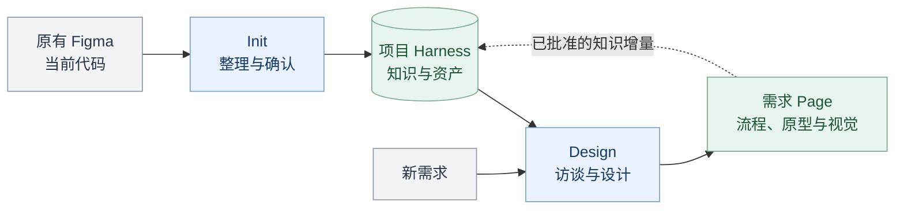
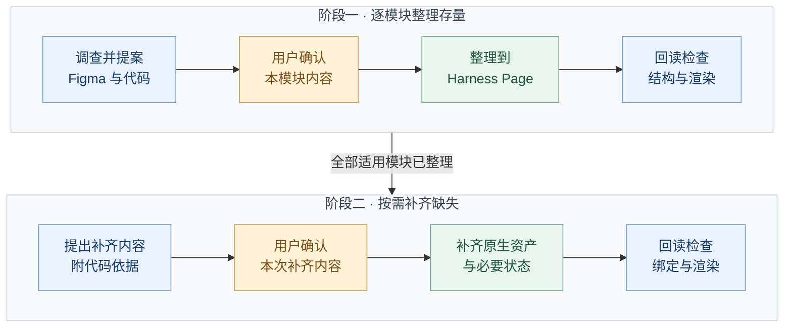
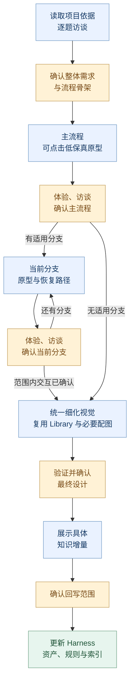
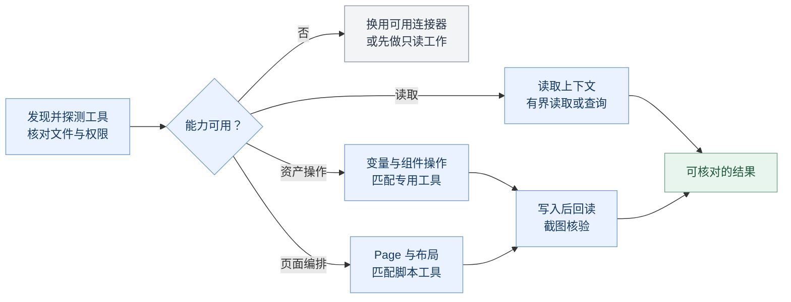

# Design Harness


一个以项目 Figma 为知识载体的 Codex 设计插件。提供两个入口：**Init 建立项目上下文，Design 在项目约束下完成新需求设计**。

图标以四个彩色组件围绕 H 留白组成。浅色与深色使用同一份透明图形，插件主题色为紫色；配色和资源用法见[品牌资源](assets/README.md)。



插件提供通用方法，项目的设计知识与资产沉淀在 Figma；每次需求产生的已确认知识再回到项目 Harness。

## 使用

| 入口 | 给它什么 | 它会做什么 |
| --- | --- | --- |
| `$design-harness-init` | Figma 项目 + 代码仓库 | 整理现状、适用 Library 来源与复用规则，逐模块确认后补齐代码已有而 Figma 缺失的知识与资产 |
| `$design-harness-design` | Figma 项目 + 新需求 | 逐题确认流程，先做主流程可点击低保真原型，再逐条补分支，统一细化视觉后确认知识回写 |

示例：

> 用 $design-harness-init 根据这个 Figma 项目和代码仓库建立 Harness。先整理现状，每个模块先给我看具体提案，确认后再生成。

> 用 $design-harness-design 读取这个 Figma 项目的 Harness，帮我设计新的设备连接流程。先确认流程骨架，再边体验原型边讨论，主流程确认后再做分支，最后细化视觉。

会话已有 Figma、仓库、范围和确认时直接沿用，不重复要求填写。团队使用需要可访问的项目及 Figma 原生读写能力；本插件不自带 Figma 连接器或账号权限。只有读取能力时仍可完成调查和访谈，写入缺口会明确报告。

## 项目知识放在哪里

- **Figma 的 design-harness Page**：AGENTS 式入口、项目上下文、风格约束、token/变量说明与样例、布局、组件库、模板库、场景库、已确认知识和需求索引。
- **每次需求的独立 Page**：确认后的流程骨架、主流程与逐条分支原型、关键分歧的局部备选、最终视觉、确认范围与知识增量。
- **代码仓库**：Agent 核查当前实现的依据，通过入口的仓库链接按需查找相关代码。
- **这个插件仓库**：通用 Skill、工作流、评价标准、Figma 内容蓝图与读取助手。

变量与样式本身是 Figma 文件级资产，Harness Page 统一呈现其语义、索引和用法。组件必须是可复用的原生资产，索引或截图不能代替组件库。

`Design Harness / Contract 1` 入口只保留一条经实际 remote 核实、无凭据的仓库链接，便于有权限的成员和 Agent 找到代码。Figma 正文面向设计师，描述产品行为、设计规则和状态；源码路径、类/函数名、commit、拉取命令与核查日志由 Agent 在任务中按需查询，不另建技术附录或本地技术档案。

项目上下文聚焦产品定位、用户任务、使用环境、渠道差异和业务边界。具体页面行为放到布局、组件或场景模块，概览只链接相关资源。设计资产的精确值、token 名称与真实 Figma 引用仍保留；“已实现”“待实现”及必要的“待实机验证”分开表达。

入口同时保留少量全局约束和模块目录。Agent 从入口读到相关模块概览，再读取所需资源和依赖；不会默认把整张 Page 或整个文件加载到上下文。Init 的 [上下文契约](skills/design-harness-init/references/context-contract.md) 定义建立方式，Design 的 [读取约定](skills/design-harness-design/references/context-loading.md) 定义按需读取与回写定位。旧 Contract 1 保持可读，源码字段不再必填；精简内容与排版时沿用既有节点和授权范围。


## 设计语言如何描述

设计风格模块参考 [Google DESIGN.md](https://github.com/google-labs-code/design.md) 的方式，将视觉意图、用途和边界与精确 token 联系起来。按总览、颜色、字体、布局、层次与纵深、形状、组件、应当与避免组织适用章节；每节说明“为什么这样设计、何时使用”，并链接项目真实变量、样式和组件，避免只列形容词或数值。

[设计描述指引](skills/design-harness-init/references/design-description.md) 与 [内容蓝图](skills/design-harness-init/assets/design-description.txt) 随两个 Skill 携带。项目内容放在 Figma 的 `style/design-description` 资源，显示标题可为 DESIGN.md；无需额外创建本地文件。已有 DESIGN.md 作为来源核对，实际导出格式只在用户要求时处理。产品设计语言与文档排版配置分开，当前代码基线与已确认待实现设计分别保留。

编写或修订描述时按需读取上游默认分支最新规范与写作理念，项目已确认规则优先；不安装上游 CLI，也不锁定其格式版本。适配说明与上游 Apache-2.0 许可证随各 Skill 分发。

## 内置 Figma 工作模板

[工作模板约定](skills/design-harness-init/references/work-templates.md) 与 [构建蓝图](skills/design-harness-init/assets/figma-work-templates.json) 提供三类可组合结构：场景流程、方案对比、规范资源。它们随两个 Skill 独立分发，不依赖固定 Figma 文件或额外连接器。

优先复用项目已有的兼容原生模板；缺少时在已授权范围内生成 Auto Layout Frame、必要组件与实例，并回读、截图检查。分发包中的蓝图不是已安装的 Figma 组件库；构建与验证完成后才记录原生资产完成。

通用内容结构由插件维护；字体、文档配色、参与端名称、画面比例和实际资产引用保存在项目设计风格模块的 `documentation/work-templates` 资源中。产品页面模板继续归项目模板库。旧通用流程分区可在明确迁移范围内移除，原稿风格资产及已填写的需求/决策先迁移并修复引用。

所有写入 Figma 的文档都遵循 [可读性约定](skills/design-harness-init/references/work-templates.md#文档排版与可读性)，包括入口、模块/资源说明与需求摘要。借用 Markdown 的标题、段落、列表、表格和链接层级，用原生富文本与 Auto Layout 呈现；正文定宽、自适应增高，按项目风格安排字重、行距与留白。`DH / Entry` 等语义 TEXT 保留完整设计内容和定位，回读与整体/局部截图分别检查。蓝图不是待直接粘贴的纯文本成品。

产品界面与评审说明都优先图形配必要短文：流程图表达任务路径，状态画面呈现反馈，局部对照帮助取舍。保留有歧义图标的短标签、重要操作后果、可读取规则和定位，不用统一字数或图文比例衡量清晰度。工作模板蓝图 1.3.0 支持主流程/分支关系、原型入口和局部比较；升级仍遵守项目现有资产与确认范围。

## Library 与插画如何使用

Init 在设计风格模块登记 `style/library-sources`，记录适用库、真实引用、使用范围及图标/插画/色彩规则；变量、组件和模板仍由各自模块维护。Design 按需复核来源，先找项目认可资产与已启用团队 Library，再查相关可访问库。未找到合适资源、资源不适用和访问受限分别表达，不把检索失败当作不存在。

缺口按类型补齐：通用图标优先成熟且风格一致的矢量来源，关系与步骤优先可编辑示意图，必要情境插画按项目上下文生成。低保真阶段只补交互判断必需的图示，正式插画在视觉阶段完善，并完成实际导入、裁切与渲染检查。颜色沿用项目语义变量；生成位图不冒充矢量或原生组件。

[视觉资产指引](skills/design-harness-init/references/visual-assets.md) 与 [来源蓝图](skills/design-harness-init/assets/library-sources.txt) 随两个 Skill 携带。它们通过当前可用工具工作，不捆绑图像服务、图标库或 Figma 连接器；缺少能力时明确未完成项。使用资产、登记来源与管理/发布源库的授权范围分别核对。

## Skill 组织

两个 Skill 各自携带本地文档、蓝图、脚本、外部来源入口和许可证，可以单独复制使用。`SKILL.md` 说明入口与读取时机，参考内容按需加载；需要上游指导时在线读取最新内容。

```text
skills/
  design-harness-init/
    SKILL.md
    agents/openai.yaml
    references/   # 整理流程、上下文契约、模块标准、状态与检查
    assets/       # Harness 入口、模块概览、资源说明蓝图
    scripts/      # Figma 读取助手
    third-party/  # Harness 架构与 DESIGN.md 参考的许可证/声明
    LICENSE
  design-harness-design/
    SKILL.md
    agents/openai.yaml
    references/   # 读取、访谈、原型、视觉资产、评价、回写与社区指导
    assets/       # 需求 Page、原型、Library 来源与知识增量蓝图
    scripts/      # Figma 读取助手
    third-party/  # Impeccable、UI/UX Pro Max 与 DESIGN.md 的许可证/声明
    LICENSE
```

根目录保留插件配置、品牌资源、开发校验/打包脚本、测试和维护文档。根目录 `assets/` 仅供插件展示使用；两个 Skill 不依赖这些品牌资源或根目录的运行文档，也不互相跨目录读取。随两者携带的读取助手、资源说明蓝图、视觉资产指引与 Library 来源蓝图、工作模板约定与蓝图、设计描述指引与蓝图/许可声明、原创许可证通过一致性校验保持同步。

## 工作方式

图中的黄色节点表示用户确认或选择，蓝色节点表示整理、设计与检查，绿色节点表示 Figma 中的产物。

### Init：先整理现状，再补齐缺失

两个阶段内部都按模块推进。先把全部适用模块的现状整理清楚，再处理代码已经实现、Figma 尚未覆盖的内容。



若无缺失，阶段一核验完成后即可用于后续设计。未确认的内容继续调整提案；已有同一范围的明确批准时直接沿用。变量、组件、模板和场景需要真实可复用资产，不能只用一份索引表示补齐完成。

### Design：先确认交互，再细化视觉

新功能或交互变化默认按下图分步推进，纯文案/配色等不影响操作的小改动可按范围简化。已有明确确认直接承接，需求与流程骨架可在一次具体确认中完成。



默认一套主方案；遇到关键交互分歧，用对应片段比较收益与代价，选定后并回。用户明确要求完整多方案时才展开。每轮只问一个关键问题并给推荐，访谈贯穿原型设计；已委托的细节与范围内修复直接完成。

流程骨架先标明重要分支与结构约束，主流程先做到可点击、可走查，确认后逐条补分支。低保真可复用已有项目组件，重点是操作、返回与反馈；交互确认后再统一处理视觉与正式插画。新事实影响已确认路径时，只重新讨论相关决定。

[原型指引](skills/design-harness-design/references/prototyping.md) 区分真实连接、预览点击和产品运行。可见箭头、静态截图不能替代可点击原型；缺少能力时报告具体缺口，调整交付由用户选择。生成位图不代表设备或后端能力已实现，模拟外部事件需明确标识。

社区方法按问题补充：Impeccable 提供设计与评价指导，UI/UX Pro Max 提供 UX、视觉与平台规则。使用实际平台与项目规范，不强制运行上游设计系统生成、安装、持久化、独立审计或多 Agent 流程。首次需要某份指导时读取默认分支最新内容，不维护版本锁；失败时说明未取得最新指导，并继续项目依据支持的工作。

第三方资料随所属 Skill 管理：Init 保留 Harness 架构来源，Design 保留 Impeccable 与 UI/UX Pro Max 的来源/许可与适配，两者携带 DESIGN.md 的来源和声明。“倾向代码”用于还原当前事实；已确认的新设计可标为**已确认设计／待实现**，后续不能用旧实现覆盖。阶段交互确认和最终设计、知识回写的范围分开记录。

## 如何选择 Figma 工具

先发现当前工具，探测连接并核对目标文件，再匹配本次需求。figma-console-mcp 与 `use_figma` 都是可选执行方式；用户指定、目标访问能力和具体操作共同决定选择。



发现 Console 后先检查实际连接。变量批量操作、组件实例化和属性修改优先匹配适用的专用工具；Page 编排与局部脚本可使用 `figma_execute` 或 `use_figma`。只加载所选方式的说明，不通过多个连接器重复执行同一次写入。

工具已注册不代表已连接，也不代表拥有写权限。所有写入仍遵循上方工作流中的确认范围；部分操作不可用时，继续完成其他有依据、可执行的工作。

## 安装与团队分发

当前发布版本为 **0.1.1**。团队成员可直接从 GitHub 安装：

```sh
codex plugin marketplace add MinLeeV5/design-harness --ref main
codex plugin add design-harness@design-harness
```

安装后新建任务，使用 `$design-harness-init` 或 `$design-harness-design`。更新时执行：

```sh
codex plugin marketplace upgrade design-harness
codex plugin add design-harness@design-harness
```

仓库内的 [marketplace 入口](.agents/plugins/marketplace.json) 指向根目录插件，安装到本地的代码来自所选 Git 引用。Git 来源与更新命令见 [OpenAI 官方说明](https://developers.openai.com/plugins/build/plugins#add-a-marketplace-from-the-cli)。

本机开发调试仍可使用 personal marketplace：通过 plugin-creator 的本地更新流程刷新缓存并重新安装。`+codex.*` 后缀仅用于本地调试，不带入发布版本；发布时同步插件清单、`package.json` 和锁文件的版本。不要手动修改安装缓存或 Codex 的 marketplace 配置。

本地校验、测试和打包统一使用 **Node.js 22+ 与 ESM**。准备 Node.js 与 npm 后，执行：

```sh
npm ci
npm run validate
npm test
npm run package -- --out dist/build
```

仓库的 [.nvmrc](.nvmrc) 默认选择 Node.js 22；使用 nvm 时可先执行 `nvm use`。

`npm run check` 可一次完成校验和全部测试。打包使用 [fflate](https://github.com/101arrowz/fflate) 这一项开发依赖；依赖安装后，校验、测试与打包均可离线运行。直接使用两个 Skill 不需要安装这些开发依赖。

输出 zip 与 SHA-256，重复构建使用新的输出目录，避免覆盖旧包。解压后包含 marketplace 根目录和插件：

```text
design-harness/
  .agents/plugins/marketplace.json
  plugins/design-harness/
```

团队成员解压到固定目录，然后使用本机 Codex CLI：

```sh
codex plugin marketplace add /path/to/design-harness
codex plugin add design-harness@design-harness
```

上述路径是解压后的 marketplace 根目录，需要替换为实际位置；解压后的源目录需保留。此操作注册本地包，不发布到远端市场。安装后新建任务使用两个入口。

## 维护与阅读

- [Init 入口](skills/design-harness-init/SKILL.md) · [模块产出标准](skills/design-harness-init/references/modules.md) · [Init 检查](skills/design-harness-init/references/evaluation.md)
- [Design 入口](skills/design-harness-design/SKILL.md) · [访谈机制](skills/design-harness-design/references/interview.md) · [Design 检查](skills/design-harness-design/references/evaluation.md)
- [交互原型](skills/design-harness-design/references/prototyping.md) · [Library 与视觉资产](skills/design-harness-design/references/visual-assets.md) · [知识更新](skills/design-harness-design/references/knowledge-update.md)
- [Impeccable 指导](skills/design-harness-design/references/impeccable.md) · [UI/UX Pro Max 适配](skills/design-harness-design/references/ui-ux-pro-max.md)
- [Init 工具选择](skills/design-harness-init/references/figma-operations.md) · [Init Console 操作](skills/design-harness-init/references/figma-console.md) · [Design Console 操作](skills/design-harness-design/references/figma-console.md)
- [Init 来源与许可](skills/design-harness-init/references/sources.md) · [Design 来源与许可](skills/design-harness-design/references/sources.md) · [验证范围](docs/validation.md)

辅助脚本测试验证读取范围、截断续读与分发包一致性，不能证明真实项目的设计质量。实际运行 Init/Design 时仍需按工作流完成具体模块的用户确认、原生资产检查和截图核验。

原创部分与 UI/UX Pro Max 适配采用 MIT；Impeccable 与 DESIGN.md 适配内容遵循 Apache-2.0，各来源保留对应许可与声明，详见 [原创许可证](LICENSE) 和各 Skill 来源说明。
