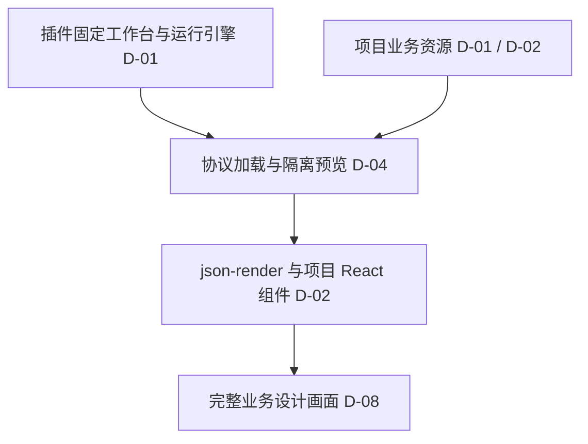

# 变更：插件固定工作台与项目业务资源分离

> **状态：** `CONFIRMED` · **确认项：** 8 D / 0 A / 0 O

## ⚡ 30 秒了解

- 插件统一维护工作台和运行引擎，项目 `design-harness/` 只维护业务设计资源，避免各项目的工作台代码分叉。[D-01](#d-01)
- 页面采用 json-render Spec，项目通过 Catalog／Registry 注册自定义 React 组件。[D-02](#d-02)
- 当前尚未对外发布，只有智工作试跑，直接统一到最新模式，不建设旧协议或多版本引擎兼容。[D-05](#d-05)
- 每套候选保存独立的完整 Spec、参数和专属实现，共享固定组件基础。[D-06](#d-06)
- 保留未来演进为设计平台的资源加载边界；完整 UI 继续按真实界面进行最高保真核对。[D-07](#d-07)、[D-08](#d-08)
- 用户已确认上述 8 项完整决定快照；目录及接口示例仍是提案，用户已明确授权在本仓库实施全部 6 项任务并验证；6 项任务实施与验证已完成。

## 🗺️ 一图读懂



> **💡 核心判断：** 工作台由插件控制，业务变化通过项目资源进入隔离预览，不修改工作台自身。[D-01](#d-01)、[D-04](#d-04)

## 当前有效决定

### 目标与职责

#### D-01

工作台作为插件内置的固定工具，不再把可编辑的工作台源码输出到使用方项目的 `design-harness/`。插件承载画布、说明、Live、定位反馈、比较、校验、构建与导出；项目承载业务设计基础、组件、页面、场景、素材、说明及证据。四个 Skill 围绕同一工具维护项目资源。

来源：用户提出“工作台作为插件中内置的一个固定工具……不可控的业务变化留在项目中”，并在分层与加载方案讨论后明确回复“OK，符合我的预期设计，可以继续细化”。

#### D-02

业务 UI 采用 json-render＋项目自定义 React 组件。页面通过 Spec 组合，组件通过 Catalog／Registry 注册；页面结构由 Spec 维护，具体外观与复杂交互由项目组件实现。

来源：用户明确选择“采用 json-render＋项目自定义 React 组件（推荐）：页面通过 Spec 组合，组件通过 Catalog／Registry 注册；结构可检查，但需维护这些契约”。

#### D-03

工作台调整页面实例属性时写回对应 Spec；组件内部布局、样式和交互的修改由 Agent 落到项目组件或 Token。两类修改有明确维护来源。

来源：用户在包含上述职责划分的架构说明后回复“OK，符合我的预期设计，可以继续细化”。

#### D-04

项目代码只进入隔离的产品预览，通过协议与工作台通信，不修改或替换工作台自身界面和行为。稳定工作台不随业务资源的编辑而变成项目代码。

来源：用户确认的架构说明包含“项目代码只进入产品预览，工作台自身的界面和行为由插件控制”。

### 当前迁移与候选

#### D-05

当前尚未发布，只有智工作的一次试跑，可以直接调整到最新模式。当前统一维护最新协议与运行引擎，不为旧试跑建设长期兼容层或多版本引擎管理；此决定不推断未来发布后的升级政策。

来源：用户回答升级策略问题：“现在还没有发布出去过，只有智工作做了一次试跑而已，可以直接调整到最新的模式都无所谓”。

#### D-06

每套候选保存独立、完整的页面 Spec 与参数，候选专属实现单独保存，共享固定组件基础。接受部分 JSON 重复，以获得清楚的隔离和重建边界，不采用基础 Spec＋候选差异补丁作为当前方案。

来源：用户明确选择“每套候选保存独立的完整 Spec 与参数（推荐）：共享固定组件基础，候选专属实现单独保存；隔离清楚、便于重建，代价是部分 JSON 重复”。

### 演进与交付质量

#### D-07

通过项目资源协议让工作台加载内容，为以后演进为设计平台保留边界。当前讨论围绕本地工作台与资源包，不把未来平台目标展开为本轮云端部署或多人协作功能。

来源：用户提出资源抽象的目的包括“后续工作台也可以顺理成章的演进为设计平台”；后续确认沿此分层继续细化。

#### D-08

完整 UI 交付按最高保真要求与指定版本的真实界面、组件和交互核对，包含适用的产品壳层、租户切换、菜单、分割线和状态。工作台与项目分离、采用本地模拟，均不降低这一质量要求；代码、Mock 与现网证据的边界分别记录。

来源：沿用用户在智工作复核中的明确要求：“这是一个完整的 UI 交付稿，所以应该按最高保真的要求与真实生产交付保持一致才对，这个也需要在 skill 中体现出来”。现有通用依据见[交付保真](../../../../skills/design-harness-init/references/fidelity.md)。

## 协议提案与待验证项

以下保留会话中的协议提案与检查方向，不新增已确认决定；落地接口以当前通用资源协议和实现为准。

### 资源组织提案

| 对象 | 会话提案 |
| --- | --- |
| 项目入口 | 项目标识、当前协议、需求索引、运行能力和资源相对路径，不写入本机插件绝对路径 |
| 组件包 | Catalog、Registry、React 实现、动作处理、Token、样式及素材 |
| 需求清单 | 页面、场景、候选、实际视口、说明关联及本需求固定基础 |
| 候选资源 | 独立完整 Spec、参数和按需保存的专属组件／素材，候选间不隐式合并结构补丁 |
| 定位与回写 | 需求、页面、候选、Spec 元素 ID、可编辑属性路径、修改值及原内容版本 |

建议的目录阅读视图如下；其中 `project.json` 等具体命名仍是提案：

```text
design-harness/
  project.json
  foundation/
  requirements/<需求>/
    manifest.json
    foundation/
    scenarios.json
    candidates/<候选>/
      pages/
      params.json
      components/
      assets/
    requirement.md
    handoff.md
  reviews/
  releases/
```

### 加载与编辑提案

- 工作台从项目入口发现资源，校验后加载需求和固定组件包，编译项目组件并在隔离预览中渲染；错误在工作台中给出具体位置，不静默省略缺失组件。
- 页面复用 json-render 原生 `root`／`elements` 结构；外围协议负责项目组织、评审与保存。
- 说明、点选、反馈和保存引用同一 Spec 元素 ID；重复列表增加实例标识，复杂组件按需暴露内部子目标。
- 即时调整先保留为未保存草稿；显式保存时验证可编辑属性、值及原内容版本，冲突时保留草稿并拒绝覆盖外部编辑。
- 填表、切换租户、运行任务等体验状态与设计资产分离，仅显式“保存为场景”时写入场景资源。
- 克隆候选复制完整资源，比较时使用独立预览状态；选定候选不自动修改公共基础。
- 工具依赖和构建缓存位于项目之外；项目扩展依赖如何声明及解析，在落实协议时确定。
- 离线交付携带已编译运行时快照以脱离插件体验；不把工作台可编辑源码重新变成项目维护内容。既有固定交付保持原样。

### 待验证项

| 检查方向 | 需要取得的信号 |
| --- | --- |
| 工具与资源分离 | 新项目只生成业务资源，工作台从插件启动；修改项目组件不改变插件工作台源码 |
| 注册与渲染 | 项目 Catalog／Registry、自定义 React 组件和完整 Spec 能由固定引擎加载，错误可定位 |
| 定位与回写 | 点选可关联实际 DOM；保存落到正确候选，外部修改产生冲突时不丢草稿 |
| 候选隔离 | 修改、比较、重新打开候选时，其 Spec、参数、专属实现与预览状态不串扰 |
| 预览保真 | 开关辅助面板不改变实际预览尺寸；智工作真实头部及目录页用于初次贯通，不能据局部样本认定整稿完成 |
| 固定交付 | 实际离线打开、交互、下载及完整性核验通过，不依赖本机插件缓存；完整 UI 另做真实基线对照 |

本轮已使用通用合成资源执行上述运行能力检查，证据见 tasks.md。智工作尚未迁移到新模式，也未修正先前的完整 UI 差异；该项目仍需单独迁移与保真复核。

## 可复用调查依据

- [现有初始化助手](../../../../skills/design-harness-init/scripts/harness.mjs)：已调整为调用插件固定工具，仅生成业务资源。原项目内 studio 耦合已移除。
- [现有构建器](../../../../workbench/lib/build.mjs)：现由固定工具分别编译工作台与候选预览，资源内嵌与候选边界已验证。
- [现有快照与导出](../../../../workbench/lib/workspace.mjs)：已调整为业务源与编译工具快照，固定目录拒绝覆盖继续生效。
- [现有运行说明](../../../../docs/html-design.md)、[当前协议](../../../../skills/design-harness-init/references/protocol.md)：已同步到 Spec、Catalog／Registry 和固定工具模式；运行能力证据在任务记录中。
- [官方 Spec](https://json-render.dev/docs/specs)、[组件注册](https://json-render.dev/docs/registry)、[状态绑定](https://json-render.dev/docs/data-binding)：支持页面 Spec、项目组件和独立运行状态的方案依据。
- [官方 Devtools](https://json-render.dev/docs/devtools)及[渲染器源码](https://github.com/vercel-labs/json-render/blob/main/packages/react/src/renderer.tsx)：已有 DOM 到 Spec key 的标记机制，默认 Devtools 面板在生产构建关闭；固定工作台的桥接需独立验证，不承诺直接接入面板即可交付。
- 实际锁定 @json-render/core 与 @json-render/react 0.21.3；安装包、依赖解析、生产预览定位和独立重建已验证，上游 main 不替代锁定版本证据。

## Agent 自主范围

无。用户尚未授权新的自主决定类别。

## 开放问题

无新的阻塞选型。协议的具体字段、目录命名和实现方式仍是上文提案，未登记为用户已确认契约；若细化中出现改变结构、可观察行为或维护方式的关键选择，继续逐项对齐。

## Planning 状态

- **讨论深度：** `lite`
- **选择来源：** 上下文默认；围绕用户提出的既有方向定向补缺，迁入时不改变深度。
- **下游状态：** `CURRENT`
- **阻塞原因：** 无规划依赖阻塞；6 项实施任务已完成并逐项验证，最终检查与专项复核通过。
- **确认依据：** 用户对列出的全部 8 项决定明确选择“确认这8项决定（推荐）：确认设计快照，代码实施另行授权”；本次确认不包含目录及接口示例。
- **当前授权：** 用户明确选择“开始实施（推荐）：按任务清单修改本仓库代码并完成验证”，授权全部 6 项任务；不包含提交、推送、发布或修改其他项目。
- **恢复入口：** 先读当前有效决定及本节，再按具体目标读取上文提案与直接相关依据。

## 决策变更记录

- 讨论过为已有草稿锁定预览引擎并显式升级；用户明确当前未发布、只有试跑，可直接采用最新模式，因此以 [D-05](#d-05) 为当前策略。未来发布后的兼容策略未作决定。
- 讨论过基础 Spec＋候选差异补丁；用户选择 [D-06](#d-06) 的完整独立候选资源。
- 创建草稿时用户仅授权持久化，因此初始状态保持 DRAFT；随后用户明确确认全部 8 项决定快照，更新为 CONFIRMED。目录及接口示例仍为提案，代码实施仍需另行授权。
- 用户随后要求继续推进，按已确认决定及仓库事实生成 6 项未完成实施任务；来源覆盖检查通过后将下游状态设为 CURRENT，不改变 8 项设计决定，不将规划就绪视为实现完成。

- 用户随后明确授权在本仓库实施全部 6 项任务并完成验证；八项决定保持不变，进入 Apply。

- Apply 已完成全部六项任务，保留 D-01 至 D-08 原决定；专项复核与验证均已记录，不据此声明真实试点 UI 已修正或用户已验收。
