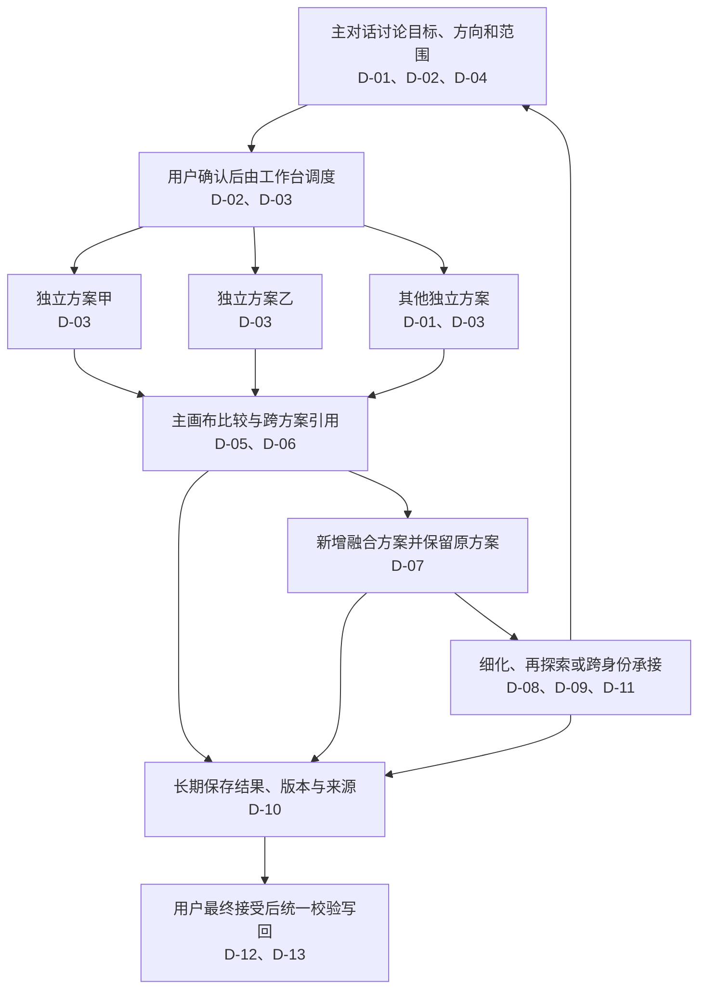

# 变更：Agent 通用多方案设计

> **状态：** `CONFIRMED` · **确认项：** 13 D / 0 A / 0 O

## ⚡ 30 秒了解

交互与视觉 Agent 共用可选择数量的多方案探索入口，主对话先讨论，再并行生成真实可操作方案。
用户在主画布比较、跨方案引用局部并生成融合结果；细化、再探索和跨身份承接保留来源与版本。
方案及设计结论随需求长期保存，最终接受才写回当前设计；正式资源冲突保持拒绝覆盖。
本快照来自当前会话的逐项选择和用户对完整方案、建立 Lite change 与实施范围的明确确认。

## 🗺️ 一图读懂

主对话承接讨论与取舍，独立分支承接实现；保存历史与接受当前设计分别处理，见 [D-03](#d-03)、[D-10](#d-10)、[D-12](#d-12)。

## 当前有效决定

### 入口、范围与编排

#### D-01

多方案是 Agent 的通用能力，交互与视觉身份均支持；输入区底部提供 1／2／3／4 个方案，默认 1。

#### D-02

多方案生成前由主 Agent 用文字与用户讨论共同目标、约束及各方向差异，确认后才生成；数量设置只控制新一轮探索的输出数量。

#### D-03

工作台编排 N 个独立 Codex thread，同时基于同一冻结基线的独立副本生成；主 Agent 统筹，复用现有 app-server 接入与分支生命周期。

#### D-04

每轮按当前设计任务确认范围，覆盖完成该任务所需页面、流程和状态；各方案可采用不同的页面数量与流程结构。

### 比较、融合与继续

#### D-05

方案在主画布比较，Agent 对话同时可用；支持放大、独立体验、跨方案点选，历史轮次分组查看。

#### D-06

用户可以直接描述跨方案取舍，也可以将不同方案的具体元素或流程加入同一对话草稿；引用关联方案、版本、页面、目标及当时画面状态，加入草稿本身不发送。

#### D-07

融合 A 的 X 和 B 的 Y 时新增独立结果 D，保留 A/B/C；融合需要适配源实现及交互依赖，并重新验证完整结果。

#### D-08

继续细化 D 时更新 D 的版本，不因数量设置而重复生成三个方案；输入区按探索、融合或调整任务呈现当前操作。

#### D-09

在 D 上再探索时默认以 D 的当前版本（包含尚未接受的调整）为基线，讨论本轮变化和保留约束，再生成 D-A／D-B／D-C 等独立子方案；允许更换基线与数量，原方案保留。

### 保存、身份与写回

#### D-10

方案结果、版本、来源关系和已确认设计结论随需求长期保存，直到用户删除；跨刷新与服务重启可回看、引用和继续，继续历史方案时可新建执行会话恢复上下文。

#### D-11

允许直接承接未接受的方案切换交互或视觉身份；每轮采用一种身份，各分支继承本轮身份、模型与共同约束，分别校验继承内容和本轮新增修改的权限。

#### D-12

保存方案与接受为当前设计分别处理；用户明确接受后只写回所选结果，统一校验完整结果及共享影响；正式源版本冲突时保留方案并拒绝覆盖。

#### D-13

实施覆盖输入区、讨论与分支编排、方案存储、主画布比较、引用与融合、提案校验及对应文档；验证实际并行、分支隔离、融合、再探索、重启恢复、跨身份与最终接受，并完成自动检查、类型检查、真实浏览器及临时项目 Codex 验证。

## Agent 自主范围

无。

## 开放问题

无。

## 仓库依据与可复用调查

- 实施前的视觉探索固定三个方向、并发两个，规划后立即生成，使用隐藏原生会话和冻结副本；见[编排](../../../../workbench/src/backend/services/explorations.mjs)、[契约](../../../../workbench/src/contracts/exploration.mjs)。
- Provider 共用 app-server 并按 thread/turn 路由；见[适配器](../../../../workbench/src/backend/adapters/codex-app-server.mjs)。
- 实施前的提案按身份检查累计文件差异且禁止未接受时切身份；需区分继承与本轮差异，见[范围校验](../../../../workbench/src/backend/services/proposal-policy.mjs)、[运行服务](../../../../workbench/src/backend/services/agent-runtime.mjs)。
- 正式设计 revision 目前包含需求资源；历史存储须独立计版本，避免保存方案使当前提案失效。公共 foundation 继续唯一，见[资源读取](../../../../workbench/src/backend/adapters/resource-store.mjs)、[资源协议](../../../../shared/references/protocol.md)。
- 实施前的比较是模态弹窗，基于共同页面登记；新方案需接入主画布并分别维护页面、场景与说明，见[比较组件](../../../../workbench/src/frontend/features/agent/ExplorationPanel.tsx)、[工作台](../../../../workbench/src/frontend/app/App.tsx)。
- 保留任务开始前全部未提交改动。本 change 承接现有视觉探索和自由批阅，不替代已完成的 workbench-free-review change。

## Planning 状态

- **讨论深度：** `lite`
- **选择来源：** 上下文默认
- **下游状态：** `CURRENT`
- **阻塞原因：** 无；用户已在当前会话明确确认完整快照并授权建立 Lite change 与实施，初始化后沿用该确认。
