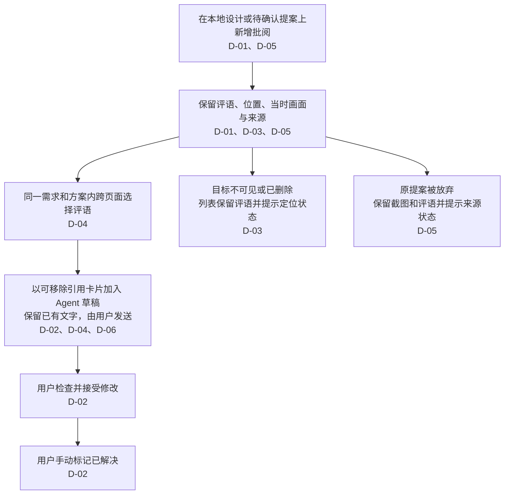

# 变更：工作台本地自由批阅

> **状态：** `CONFIRMED` · **确认项：** 6 D / 0 A / 0 O

## ⚡ 30 秒了解

- 在本地工作台的设计画面任意位置新增批阅，已提交评语跨刷新和服务重启保留。
- 批阅跟随当前设计元素，同时保存批阅时画面；目标不可见或已删除时保留记录并提示定位状态。
- 同一需求、同一方案内可跨页面多选评语，连同位置、页面和截图加入该方案的 Agent 草稿。
- 已保存设计和待确认提案均可批阅；提案来源及后续状态与评语一起保留，修改经用户检查并接受后，由用户标记已解决。

## 🗺️ 一图读懂

> **💡 核心判断：** 批阅记录独立于当前元素是否可见、原提案是否保留；修改是否完成由用户确认，见 [D-02](#d-02)、[D-03](#d-03) 和 [D-05](#d-05)。

## 当前有效决定

### 目标与使用范围

#### D-01

首版提供本地工作台自由批阅，允许在设计画面任意位置新增评语；已提交评语刷新或重启后仍保留。

来源：用户最初要求“随意在任何位置增加批阅”，随后明确选择“第一版先做本地工作台批阅，评语刷新或重启后仍保留”。本轮未选择离线反馈导入或在线多人协作。

#### D-04

同一需求、同一方案内可以跨页面多选评语，并将每条评语的位置、所属页面和截图一起加入该方案的 Agent 草稿；不同方案分别处理。

来源：用户明确选择同一需求、同一方案内跨页面多选，并确认每条评语携带位置、页面与截图。

### 批阅与修改流程

#### D-02

支持把一条或多条评语连同位置和上下文，通过“添加到 Agent”按钮加入 Agent 草稿输入区。由用户编辑、发送；修改经用户检查并接受后，再由用户手动标记评语已解决。

来源：用户明确选择按需交给 Agent，并提出“提供一个按钮加到 Agent 的草稿输入框中”。沿用所选方案中由用户确认解决的约定。

#### D-03

批阅跟随当前设计中的元素，同时保留批阅时的画面作为参考；目标暂不可见或已删除时，列表仍保留评语并提示定位状态。

来源：用户明确选择跟随当前设计、保留当时画面与定位状态提示。

#### D-05

已保存设计和待确认提案都可以新增批阅。评语记录提案来源；提案接受后继续跟随设计，提案放弃后保留截图和评语并提示来源状态。

来源：用户明确选择已保存设计与待确认提案均可批阅，并逐项确认接受、放弃后的记录行为。

### 工作台交互

#### D-06

首版采用以下交互流程：

- 顶部增加独立“评审”入口，以覆盖式列表面板展示评语，保持产品画面尺寸和操作状态。
- 点击“添加批阅”后落针、输入、保存，完成后恢复产品操作。
- 列表支持跨页面查看、按页面和处理状态筛选、回复、解决与重新打开；点击评语定位当前元素，或查看批阅时截图。
- “添加到 Agent”将评语以可移除的引用卡片加入草稿，保留已有文字，由用户发送。

来源：用户在迁入讨论记录后明确选择“采用这套流程”。此项关闭原开放问题 O-01。

## Agent 自主范围

无新增自主决策类别。用户已授权建立 Lite change、维护设计记录及生成 Lite 实施任务，并以“开始实施”授权按已确认范围实施与验证。

## 仓库依据与可复用调查

以下为仓库事实和只读探查结论，不是额外的用户决定。

- 现有编号标注关联预先编写的交互说明；稳定目标、重复实例与 DOM 点选可以复用，但当前 `node-*` DOM 标识由单次预览运行生成，持久批阅不能只保存该标识。见[编号说明](../../../docs/html-design.md#编号说明与-agent)与[点选实现](../../../workbench/src/preview/inspector.ts)。
- 预览可捕获当时的 DOM、表单值、滚动和弹层画面，现有截图链路可作为批阅留图的基础；它不承诺恢复任意组件的全部运行状态。见[画面捕获](../../../workbench/src/preview/capture.ts)与[截图适配器](../../../workbench/src/backend/adapters/design-capture.mjs)。
- Agent 会话按需求、方案隔离，现有继续提案请求还绑定原提案页面。跨页批阅引用需要补充上下文入口，不能仅复用单个点选附件或把全部截图塞入最多三张的用户参考图槽位。见[会话与草稿](../../../workbench/src/frontend/features/agent/use-agent.ts)、[上下文地图](../../../workbench/src/backend/adapters/agent-context.mjs)与[运行服务](../../../workbench/src/backend/services/agent-runtime.mjs)。
- 接受提案前校验完整设计 revision；评审记录需要独立于设计资源版本，否则新增评语可能使待确认提案发生源版本冲突。项目已有 `reviews/` 目录，需求内同名目录也从 `resourceFiles` 排除。见[工作区结构](../../../shared/references/workspace.md)、[资源文件筛选](../../../workbench/src/backend/adapters/filesystem.mjs)和[源版本计算](../../../workbench/src/backend/adapters/resource-store.mjs)。
- 临时提案会过期，服务关闭清理任务和会话；完整提案另开为独立 HTML 预览。因此持久批阅需要独立保存来源记录，并为本地提案预览补齐评审连接，不依赖临时提案目录长期存在。见[运行服务](../../../workbench/src/backend/services/agent-runtime.mjs)与[完整提案预览](../../../workbench/src/frontend/features/agent/AgentPanel.tsx)。
- 本地 HTTP 的 Host、Origin、父端令牌校验与产品 iframe 隔离需要沿用；新增批阅能力不能依赖产品代码直接访问本地文件。见[构建与隔离](../../../docs/html-design.md#构建与隔离)及[HTTP 路由](../../../workbench/src/backend/http/routes.mjs)。

讨论深度为 Full：已从需求侧核对本地、离线收集、在线协作等使用边界，从技术侧核对定位、截图、持久化、跨页上下文、提案生命周期及现有隔离边界。结论可复用；以下实现建议不自动扩展 D/A。

## 实现建议（非 D/A）

以下来自本轮 Agent 的调查与建议，供后续实施方案细化使用，不计入 D/A。涉及关键行为、核心做法或职责边界的变化仍需按已确认设计对齐，不能据此增加下游语义。

- 列表默认展示当前方案跨页面的未解决评语；草稿引用卡片展示页面、评语摘要和截图缩略图。
- 批阅引用以目标会话的设计为修改基线，不自动合并多个提案。
- 处理状态、定位状态、设计来源分别维护，定位失效或提案接受、放弃都不自动改变评语是否解决。
- 评语、截图、来源记录保存在项目的 `design-harness/reviews/` 下，由本地服务管理，使用独立版本；保存失败时保留输入并支持重试。
- 查看评语时定位当前设计，不自动恢复或覆盖产品输入。原提案过期或重启后不可用时，保留评语、截图并提示来源状态；无法核实的来源状态标为待核实。

验证建议沿用[验证范围](../../../docs/validation.md)：覆盖任意位置落针、滚动与布局变化、弹窗关闭和目标删除、跨页多选与方案隔离、已有草稿保留、提案接受／放弃／过期，以及跨刷新和重启的记录与截图恢复；检查写评语不导致设计 revision 冲突。实施按上述检查取得实际验证证据，进度以 tasks.md 为准。

## 开放问题

无。O-01 已由用户明确采用首版交互流程的答复关闭，见 [D-06](#d-06)。

## Planning 状态

- **讨论深度：** `full`
- **选择来源：** 上下文默认；用户要求探索如何设计功能，沿用 topic-only 阶段的 Full 讨论深度。Lite 为本 change 的 schema，不改变讨论深度。
- **下游状态：** `CURRENT`
- **确认来源：** 用户在展示全部六项决定、后续产物及主要验证方式后，明确选择“确认，设计定稿”；确认日期为 2026-11-02。
- **阻塞原因：** 无。完整 6 D / 0 A / 0 O 快照已确认，[Lite 实施任务](tasks.md) 已完成封闭投影及来源覆盖检查，下游状态为 CURRENT；共 9 项交付结果，实施进度为 9/9；自动检查、真实浏览器、真实 Codex、类型与异地分发验证均通过，证据见 tasks.md 的实施与验证记录。
